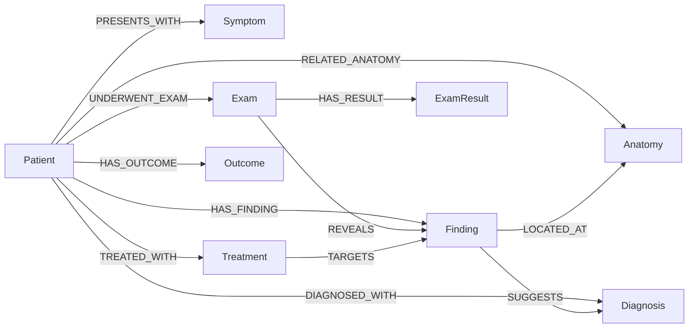
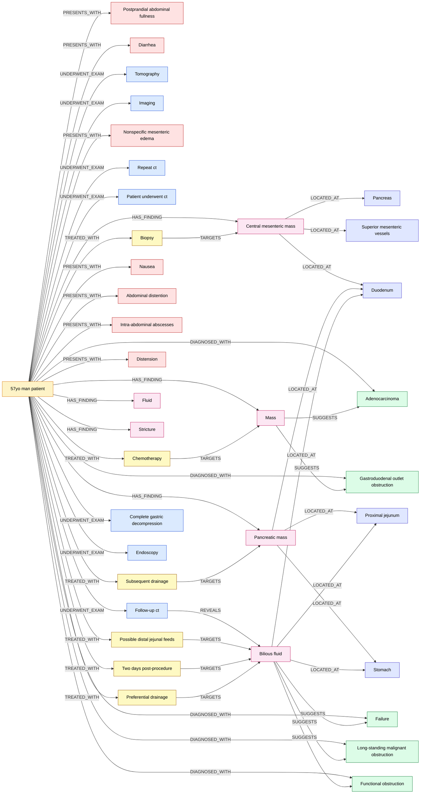

# Projeto Extração de Grafo de Conhecimento Clínico com Espaço Vetorial de N-gramas

# Project Clinical Knowledge Graph Extraction with an N-gram Vector Space

Estrutura desta pasta (simplificação do Cookiecutter Data Science, conforme o template):

```
project2
├── README.md                      <- este documento
├── guia-ideias.md                 <- guia de ideias fornecido pelo professor
├── data
│   ├── external
│   │   └── medical_vocab.json     <- vocabulário médico do Projeto 1 (protótipos das categorias)
│   ├── interim
│   ├── processed
│   │   ├── 01-project1-pos-tagging-graph.md   <- grafo do Projeto 1 (baseline, regras)
│   │   └── 02-project2-pos-tagging-graph.md   <- grafo do Projeto 2 (n-gramas + ML)
│   └── raw                        <- amostra do MultiCaRe (cases, metadata, data_dictionary)
├── pipelines
│   ├── notebooks
│   │   └── demo_projeto2.ipynb    <- demonstração executável (P1 × P2)
│   └── workflows
├── src
│   ├── README.md                  <- instruções de instalação/execução
│   └── 02_project2_pos_tagging_pipeline.py
└── assets
    ├── images
    └── slides
```

## Slides

[`PDF dos slides`](assets/slides/slides.pdf).

## Demonstração Executável

[](https://colab.research.google.com/github/Cl4nyz/Natural-Language-Processing/blob/main/project2/pipelines/notebooks/demo_projeto2.ipynb)
[](https://mybinder.org/v2/gh/Cl4nyz/Natural-Language-Processing/main?labpath=project2%2Fpipelines%2Fnotebooks%2Fdemo_projeto2.ipynb)

O notebook [`pipelines/notebooks/demo_projeto2.ipynb`](pipelines/notebooks/demo_projeto2.ipynb) executa os pipelines do Projeto 1 e do Projeto 2 lado a lado, sem modificá-los, e mostra:

1. o espaço vetorial de N-gramas (dimensões, unigramas × bigramas, pesos IDF);
2. a classificação de sintagmas pelos dois métodos, com o **protótipo mais próximo** que explica cada decisão do Projeto 2, incluindo os acertos e erros discutidos no [confronto](#confronto-com-trabalho-anterior);
3. os grafos dos dois projetos para um caso clínico configurável (`CASE_IDX`), com tabelas de nós e arestas, métricas comparativas e visualização;
4. a sensibilidade do grafo ao limiar de similaridade de cosseno;
5. a comparação de cobertura e sobreposição (Jaccard) entre os dois métodos em 30 casos do MultiCaRe.

O notebook já está salvo com as saídas, então pode ser lido direto no GitHub. No Colab ou no Binder, ele clona o repositório e instala as dependências automaticamente.

Para executar apenas o pipeline do Projeto 2, a partir da raiz do repositório (detalhes em [`src/README.md`](src/README.md)):

```bash
pip install nltk scikit-learn pandas networkx tabulate
python project2/src/02_project2_pos_tagging_pipeline.py
```

## Metodologia

O Projeto 2 parte da abordagem de _POS-tagging_ do Projeto 1 ([`src/project1/02_pos_tagging_pipeline.py`](../src/project1/02_pos_tagging_pipeline.py)) e substitui o ponto mais frágil dela: a **classificação de entidades por busca exata em dicionário**. No Projeto 1, um sintagma nominal só recebia um tipo (`Symptom`, `Diagnosis` etc.) se contivesse literalmente algum termo de `medical_vocab.json`. Caso contrário, era descartado como `Unknown`. No Projeto 2, essa etapa passa a ser feita por um **classificador de vizinho mais próximo (1-NN) em um espaço vetorial TF-IDF de unigramas e bigramas**, sem LLMs, sem embeddings e sem Transformers.

```
 cases.csv ──► [1] Segmentação ──► [2] Tokenização ──► [3] POS-tagging ──► [4] Chunking de
 (texto)        em sentenças        por regex           (NLTK perceptron)     sintagmas nominais
                                                                                    │
 medical_vocab.json ──► [5a] TF-IDF de 1-2-gramas ──► matriz de protótipos          │
 (274 termos, 7 tipos)       (ajustado nos termos)          │                       ▼
                                                            └──────► [5b] Classificação 1-NN
                                                                     por similaridade de cosseno
                                                                     (limiar 0,35 → senão Unknown)
                                                                                    │
                                                                                    ▼
                         [7] Exportação ◄── [6] Construção do grafo (regras de relação
                         nós/arestas +          por tipo + gatilhos verbais/preposicionais)
                         Mermaid
```

**Estágios:**

1. **Segmentação em sentenças** com `nltk.sent_tokenize`.
2. **Tokenização por expressões regulares** que preservam medidas com unidade (`20 mm`, `3 mg/L`), termos hifenizados (`intra-abdominal`, `follow-up`) e pontuação.
3. **POS-tagging** com o _averaged perceptron tagger_ do NLTK.
4. **Chunking** com a gramática `NP: {<DT>?<JJ.*|CD|NN.*>+ ...}` (`RegexpParser`), seguido da remoção de _stopwords_ e de preposições residuais no fim do sintagma (`... secondary to`, `... of`).
5. **Classificação vetorial com N-gramas (novidade do Projeto 2):**
   - **(a)** Cada um dos 274 termos do vocabulário médico é tratado como um "documento" rotulado com sua categoria. Um `TfidfVectorizer(ngram_range=(1, 2))` é ajustado sobre eles, e cada unigrama e bigrama (ex.: `abdominal`, `abdominal pain`, `bowel obstruction`) vira uma dimensão do espaço.
   - **(b)** Cada sintagma extraído no estágio 4 é projetado no mesmo espaço e recebe a categoria do protótipo com maior similaridade de cosseno, desde que ela seja ≥ 0,35. Abaixo do limiar, o sintagma é rotulado `Unknown` e descartado. Valores laboratoriais continuam sendo capturados por regex (`ExamResult`).
6. **Construção do grafo** (`networkx.DiGraph`) centrada no paciente. O tipo da entidade define a aresta com o paciente (`PRESENTS_WITH`, `UNDERWENT_EXAM`, `DIAGNOSED_WITH`, ...). Relações entre entidades (`REVEALS`, `LOCATED_AT`, `SUGGESTS`, `TARGETS`) são criadas quando a sentença contém gatilhos verbais (`revealed`, `showed`, ...) ou preposicionais (`abutting`, `encasing`, `in`, ...) e há um exame ou achado anterior no contexto.
7. **Exportação** das tabelas de nós e arestas (no formato do Projeto 1) e de um diagrama Mermaid em [`data/processed/02-project2-pos-tagging-graph.md`](data/processed/02-project2-pos-tagging-graph.md).

O núcleo da mudança está em poucas linhas:

```python
vectorizer = TfidfVectorizer(ngram_range=(1, 2), analyzer='word', lowercase=True)
X_vocab = vectorizer.fit_transform(train_terms)          # 274 protótipos rotulados

entity_vector = vectorizer.transform([entity_lower])     # sintagma vindo do POS-tagger
cosine_sims = cosine_similarity(entity_vector, X_vocab)[0]
best_idx = cosine_sims.argmax()
category = train_categories[best_idx] if cosine_sims[best_idx] >= 0.35 else "Unknown"
```

**Papel dos N-gramas e do TF-IDF.**

- Com `ngram_range=(1, 2)`, o espaço tem uma dimensão para cada palavra e para cada **expressão composta de duas palavras** do vocabulário. Assim, um sintagma como _"gastroduodenal outlet obstruction"_ pode casar com o protótipo _"bowel obstruction"_ pelo unigrama `obstruction`, e um bigrama inteiro compartilhado conta como evidência extra.
- O **IDF** é calculado sobre os próprios termos do vocabulário. Palavras que aparecem em muitos protótipos (ex.: `pancreas`, em _head/body/tail of the pancreas_) recebem peso menor, e palavras que aparecem em poucos (ex.: `adenocarcinoma`) dominam o vetor. Isso permite que _"invasive ... adenocarcinoma"_ seja classificado como `Diagnosis` mesmo sem casar exatamente com _"pancreatic ductal adenocarcinoma"_.
- A **normalização L2** e a **similaridade de cosseno** geram um escore contínuo em [0, 1]. Com ele, o limiar de 0,35 funciona como um filtro de confiança: sintagmas sem nenhum n-grama em comum com o vocabulário (_"Figure 1"_, _"three months"_, _"outside surgeon"_) têm similaridade 0 e são descartados.

### Confronto com Trabalho Anterior

A comparação foi feita **no mesmo caso clínico** (PMC9387390_01, homem de 57 anos com adenocarcinoma e obstrução gastroduodenal), executando o pipeline de POS-tagging do Projeto 1 e o do Projeto 2. Os dois compartilham tokenização, chunking e regras de relação, então **a única variável alterada é o classificador de entidades**. Isso torna a comparação controlada.

| Métrica (caso PMC9387390_01)             | Projeto 1 (dicionário exato) | Projeto 2 (TF-IDF 1-2-gramas + 1-NN) |
| ---------------------------------------- | ---------------------------: | -----------------------------------: |
| Nós (excluindo o paciente)               |                           22 |                                   36 |
| Arestas                                  |                           30 |                                   51 |
| Arestas entre entidades (sem o paciente) |                           12 |                                   21 |
| `Symptom` / `Exam` / `Finding`           |                    4 / 6 / 4 |                            7 / 7 / 6 |
| `Anatomy` / `Treatment` / `Diagnosis`    |                4 / 4 / **0** |                        5 / 6 / **5** |
| Entidades em comum                       |                           21 |                                   21 |
| Entidades exclusivas                     |                            1 |                                   15 |

Na **inspeção manual** das 15 entidades encontradas apenas pelo Projeto 2 (não há anotação de referência no MultiCaRe, então não é possível calcular precisão e revocação formais):

| Avaliação                          | Entidades exclusivas do Projeto 2                                                                                                                                                                                                                                                                                                                   |
| ---------------------------------- | --------------------------------------------------------------------------------------------------------------------------------------------------------------------------------------------------------------------------------------------------------------------------------------------------------------------------------------------------- |
| Plausíveis e com tipo correto (11) | _postprandial abdominal fullness_, _abdominal distention_ (Symptom); _adenocarcinoma_, _gastroduodenal outlet obstruction_, _long-standing malignant obstruction_, _functional obstruction_ (Diagnosis); _superior mesenteric vessels_ (Anatomy); _imaging_ (Exam); _bilious fluid_, _fluid_ (Finding); _possible distal jejunal feeds_ (Treatment) |
| Tipo errado (2)                    | _intra-abdominal abscesses_ → Symptom (deveria ser Finding); _complete gastric decompression_ → Exam (é um objetivo terapêutico)                                                                                                                                                                                                                    |
| Ruído (2)                          | _failure_ (de _"failure of progression"_) → Diagnosis; _two days post-procedure_ → Treatment                                                                                                                                                                                                                                                        |

**Principais conclusões:**

- **Ganho de cobertura:** o Projeto 1 não encontrou **nenhum diagnóstico** neste caso, porque nenhum dos 21 diagnósticos do vocabulário aparece literalmente no texto. O Projeto 2 recuperou o diagnóstico principal (_adenocarcinoma_) e as complicações obstrutivas, o que também ativou as relações `SUGGESTS` (achado → diagnóstico), ausentes no grafo do Projeto 1.
- **Custo em precisão:** a generalização por n-gramas compartilhados também gera erros previsíveis. _"failure"_ casa com _"renal failure"_, _"post-procedure"_ casa com _"whipple procedure"_ e _"intra-abdominal"_ casa com termos de sintoma abdominal. Como não há _stemming_, _"abscesses"_ não casa com o protótipo _"abscess"_ (Finding).
- **Regressão pontual:** o nó _"CT"_, encontrado pelo Projeto 1, foi perdido. O Projeto 2 descarta sintagmas com até 2 caracteres antes da vetorização, um filtro de ruído que também elimina siglas legítimas.
- **Limitações compartilhadas:** nenhuma das duas abordagens extraiu _gastrojejunostomy_, _stent_, _emesis_, _anastomotic leak_, _delayed gastric emptying_ ou qualquer `Outcome` (ex.: _discharged_, _hospice_). A revocação continua limitada pelo chunker e pelo tamanho do vocabulário de protótipos.

Em resumo, neste caso o aprendizado por proximidade no espaço de n-gramas **complementa** as regras do Projeto 1: amplia a cobertura (+64% de nós, +75% de arestas) com cerca de 4 erros a cada 15 novas entidades. Os erros observados apontam melhorias diretas: _stemming_ ou n-gramas de caracteres, um limiar calibrado por categoria e uma lista de exceções para siglas clínicas curtas.

## Trabalhos Estudados

- **Guia de Ideias do professor** ([`guia-ideias.md`](guia-ideias.md)): a abordagem se enquadra na _Possibilidade 1 (Identificação de entidades)_, usando n-gramas para representar expressões clínicas compostas, combinada com a _Possibilidade 5 (Comparação entre representações)_ no confronto com o Projeto 1.
- **Jurafsky & Martin, _Speech and Language Processing_** (cap. de N-gramas e de semântica vetorial): fundamentação de modelos de N-gramas e da representação TF-IDF com similaridade de cosseno como alternativa esparsa e interpretável a _embeddings_.
- **Salton & Buckley (1988)**: trabalho clássico sobre ponderação de termos (TF-IDF) em recuperação de informação, base do esquema de pesos usado no classificador.
- **Ji et al. (2022)**: _survey_ sobre grafos de conhecimento que orientou o modelo de nós e arestas e a separação entre extração de entidades e de relações.

## Modelo Lógico

O modelo de grafo de propriedades é centrado no paciente. As arestas entre entidades (`REVEALS`, `LOCATED_AT`, `SUGGESTS`, `TARGETS`) carregam o raciocínio clínico do caso.



| Tabela  | Colunas                                                       |
| ------- | ------------------------------------------------------------- |
| Nós     | `node_id`, `type`, `label`, `attributes` (ex.: `size=20 mm`)  |
| Arestas | `edge_id`, `source_id`, `target_id`, `relation`, `attributes` |

## Análises que podem ser realizadas

1. **Comparação de extratores por caso:** como os dois grafos usam o mesmo esquema, a diferença entre eles (entidades e arestas exclusivas) mostra o que cada método captura. Isso também pode servir de base para uma anotação manual que permita calcular precisão e revocação.
2. **Cadeias de raciocínio diagnóstico:** caminhos `Exam → REVEALS → Finding → SUGGESTS → Diagnosis` reconstroem como o diagnóstico foi alcançado. No caso estudado, _follow-up CT → bilious fluid → long-standing malignant obstruction_.
3. **Localização anatômica de achados:** agregar `Finding → LOCATED_AT → Anatomy` em vários casos mostra quais estruturas concentram lesões (ex.: duodeno e jejuno proximal nos casos pancreáticos).
4. **Perfil de tratamento por diagnóstico:** relacionar `Treatment → TARGETS → Finding → SUGGESTS → Diagnosis` para observar quais intervenções acompanham cada condição.
5. **Análise de confiança:** registrar a similaridade de cosseno como atributo do nó permitiria filtrar o grafo por confiança e estudar o efeito do limiar sobre o número de nós e de erros.

## Ferramentas

- **Python 3.12**: linguagem do pipeline.
- **NLTK**: segmentação em sentenças, _POS-tagging_ (_averaged perceptron_), _chunking_ com `RegexpParser` e _stopwords_.
- **scikit-learn**: `TfidfVectorizer` (espaço de 1-2-gramas) e `cosine_similarity` (classificação 1-NN). É a única dependência nova em relação ao Projeto 1.
- **NetworkX**: representação do grafo dirigido.
- **pandas / tabulate**: geração e impressão das tabelas de nós e arestas.
- **Mermaid**: visualização do grafo, renderizada diretamente pelo GitHub no Markdown.

## Resultados

Grafo extraído pelo Projeto 2 para o caso PMC9387390_01 (arquivo completo em [`data/processed/02-project2-pos-tagging-graph.md`](data/processed/02-project2-pos-tagging-graph.md); o grafo do Projeto 1 para o mesmo caso está em [`data/processed/01-project1-pos-tagging-graph.md`](data/processed/01-project1-pos-tagging-graph.md)):



O grafo recupera a narrativa central do caso: massa mesentérica que envolve pâncreas, vasos mesentéricos superiores e duodeno (`LOCATED_AT`), biópsia com diagnóstico de **adenocarcinoma** (`Mass → SUGGESTS → Adenocarcinoma`), quimioterapia e evolução para **obstrução gastroduodenal**. Essa cadeia diagnóstica não existe no grafo do Projeto 1, que não identificou nenhum nó `Diagnosis`. Os erros discutidos no [confronto](#confronto-com-trabalho-anterior) aparecem no grafo como nós isolados ou mal tipados (_Failure_, _Two days post-procedure_). Isso mostra que o próximo passo natural é calibrar o limiar e enriquecer a representação, por exemplo com n-gramas de caracteres para lidar com variações morfológicas.

## Como Modelos de Linguagem foram Usados

Modelos de linguagem foram usados **apenas na escrita da documentação**: redação e organização deste README e do [`src/README.md`](src/README.md). Nenhum modelo de linguagem, _embedding_ ou Transformer é usado no pipeline de extração. A classificação de entidades depende exclusivamente de TF-IDF sobre n-gramas e similaridade de cosseno.

## Referências Bibliográficas

- Nievas Offidani, M., Roffet, F., González Galtier, M. C., Massiris, M., & Delrieux, C. (2025). An Open-Source Clinical Case Dataset for Medical Image Classification and Multimodal AI Applications. _Data_, 10(8), 123. https://doi.org/10.3390/DATA10080123
- Ji, S., Pan, S., Cambria, E., Marttinen, P., & Yu, P. S. (2022). A Survey on Knowledge Graphs: Representation, Acquisition, and Applications. _IEEE Transactions on Neural Networks and Learning Systems_, 33(2), 494–514. https://doi.org/10.1109/TNNLS.2021.3070843
- Jurafsky, D., & Martin, J. H. _Speech and Language Processing_ (3rd ed. draft). Capítulos "N-gram Language Models" e "Vector Semantics and Embeddings". https://web.stanford.edu/~jurafsky/slp3/
- Jurafsky, D. _CS 124: From Languages to Information_, Stanford University, Winter 2026. https://web.stanford.edu/class/cs124/
- Salton, G., & Buckley, C. (1988). Term-weighting approaches in automatic text retrieval. _Information Processing & Management_, 24(5), 513–523. https://doi.org/10.1016/0306-4573(88)90021-0
- Bird, S., Klein, E., & Loper, E. (2009). _Natural Language Processing with Python_. O'Reilly. https://www.nltk.org/book/
- Pedregosa, F. et al. (2011). Scikit-learn: Machine Learning in Python. _Journal of Machine Learning Research_, 12, 2825–2830.
